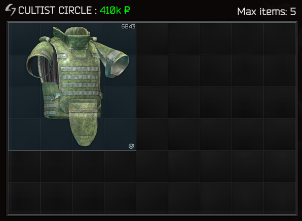

A simple client mod that shows the total value of all items in the Cultist Circle.

The color of the total value follows these rules:
* White: No items
* Red: <200k
* Yellow: >=200k and <400k
* Green: >=400k